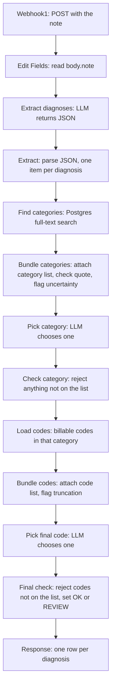

# Architecture

## Flow

## Nodes

| Node | Type | Job |
|---|---|---|
| Webhook1 | Webhook | Receives POST /webhook/icd-code and replies with every row when the last node finishes. |
| Edit Fields | Set | Copies body.note into a note field. |
| Extract diagnoses | AI Agent (Groq Chat Model) | Returns JSON with a search term and an exact quote for each diagnosis. |
| Extract | Code | Parses that JSON into one item per diagnosis. |
| Find categories | Postgres | Finds the 3-character categories whose billable codes match the search term. Always Output Data is on. |
| Bundle categories | Code | Pairs each diagnosis with its category list. Checks the quote is exact text from the note. Flags uncertainty wording. |
| Pick category | AI Agent (Groq Chat Model2) | Chooses one category from the list. |
| Check category | Code | Rejects a category that is not on the list. Blanks the category for uncertain diagnoses. |
| Load codes | Postgres | Loads the billable codes in the chosen category, capped at 200. Always Output Data is on. |
| Bundle codes | Code | Attaches the codes to each diagnosis. Flags a truncated list. |
| Pick final code | AI Agent (Groq Chat Model3) | Chooses one code. Batch Size 1 and Delay Between Batches 65000 ms, to stay under the model provider's tokens-per-minute limit. |
| Final check | Code | Removes dots, rejects a code that is not on the list, and sets status OK or REVIEW with flags. |

## Where the safeguards live

| Risk | Where it is handled |
|---|---|
| The model invents a category | Check category |
| The model invents a code | Final check (it rejected J18.9 for an empty list) |
| The quote is not from the note | Bundle categories |
| The diagnosis is uncertain ("possible") | Bundle categories flags it. Check category and Final check withhold the code. |
| A search finds nothing | Always Output Data on Find categories and Load codes |
| A category is too large for one request | Bundle codes flags it as truncated |

## Not in this workflow

- The Alphabetic Index.
- The care setting (inpatient or outpatient) as an input.
- ICD-10-PCS and CPT.
